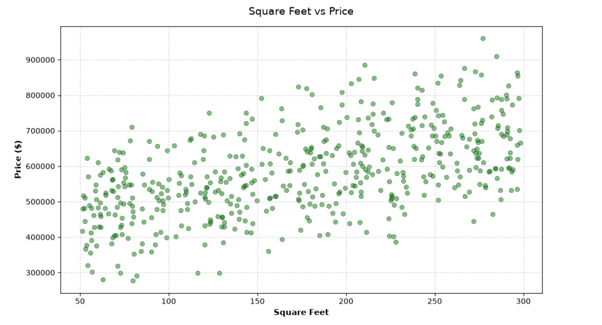
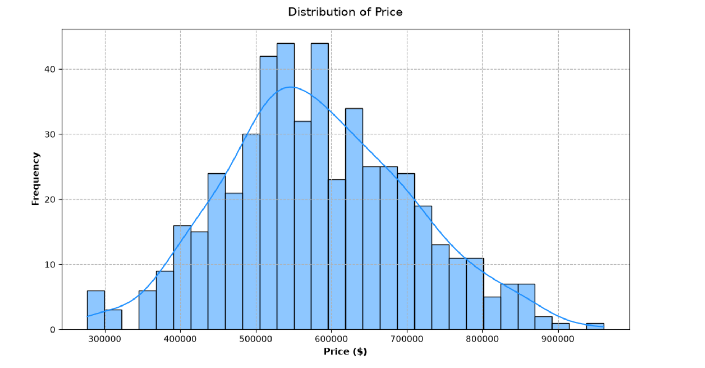
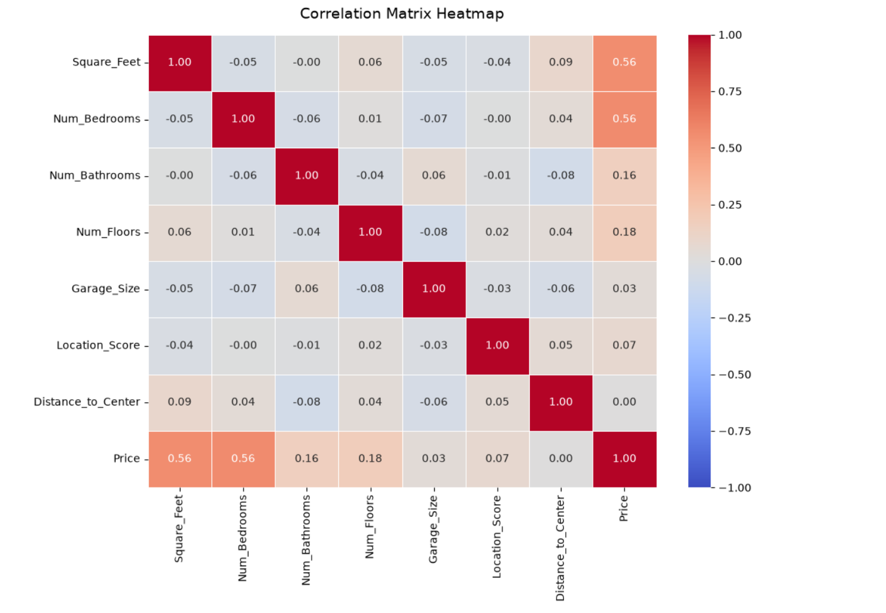
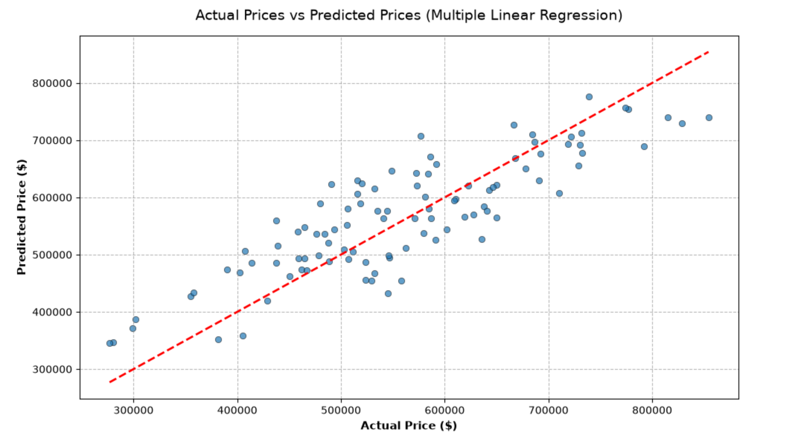
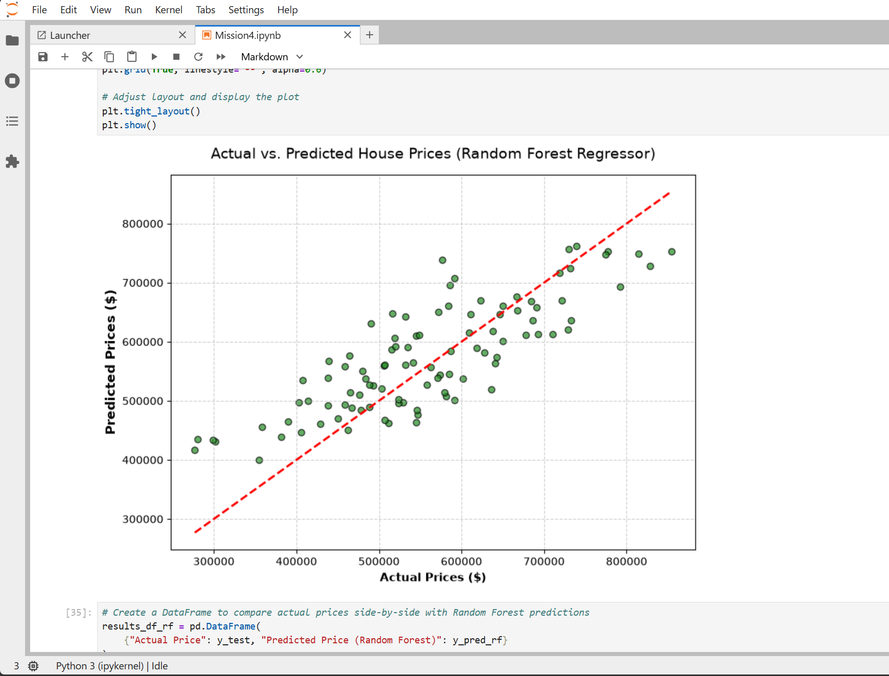

# House Price Prediction: Multiple Linear Regression vs Random Forest

Predicting house prices from property features using **Multiple Linear Regression (MLR)** and a **Random Forest Regressor**, built in a Microsoft Fabric notebook with Python (pandas, seaborn, scikit-learn).

## Project Overview

The goal is to build a model that predicts the **Price** of a house from its characteristics, then compare a simple linear model against a tree-based ensemble to see which generalises better.

**Dataset:** 500 houses, 8 columns, no missing values.

| Feature | Description |
|---|---|
| `Square_Feet` | Total area of the house |
| `Num_Bedrooms` | Number of bedrooms |
| `Num_Bathrooms` | Number of bathrooms |
| `Num_Floors` | Number of floors |
| `Garage_Size` | Size of the garage |
| `Location_Score` | Desirability score of the location |
| `Distance_to_Center` | Distance (km) to the city centre |
| `Price` | **Target variable** |

## Tools & Libraries

Python 3.15, pandas, NumPy, Matplotlib, Seaborn, scikit-learn, Azure Blob Storage SDK, Microsoft Fabric notebooks (with MLflow autologging).

## Approach

### 1. Data loading and inspection
- Loaded the CSV from Azure Blob Storage into a DataFrame (`df_house_price`).
- Checked the first rows, data types and nulls: 500 rows, all columns numeric, **no missing values**.

### 2. Exploratory Data Analysis (EDA)
- **Summary statistics** (`describe()`): prices range from about $277k to $961k, with a mean of about $582k.
- **Scatter plot (Square Feet vs Price)**
- **Histogram (Price distribution)**
- **Correlation matrix / heatmap**

_Square Feet vs Price_

_Price Distribution_

_Correlation Matrix / Heatmap_

### 3. Modelling
1. Split the data into features `X` (all columns except `Price`) and target `y` (`Price`).
2. Train/test split: **80% / 20%** (400 train, 100 test), `random_state=42`.
3. **Model 1:** `LinearRegression` (MLR).
4. **Model 2:** `RandomForestRegressor` with 200 trees (`n_estimators=200`, `random_state=42`).
5. Evaluated both on the held-out test set using **RMSE**, and plotted actual vs predicted prices against the ideal `y = x` line.

_Linear Regression_

_Random Forest Regressor_

## Key Findings

### EDA insights
- **Price is roughly bell-shaped and fairly symmetric**, centred around $550k–$600k with no extreme outliers, which suits linear regression.
- **Square_Feet (r ≈ 0.56) and Num_Bedrooms (r ≈ 0.56)** have the strongest correlations with price.
- **Num_Floors (≈ 0.18) and Num_Bathrooms (≈ 0.16)** show weak positive relationships.
- **Location_Score, Garage_Size and Distance_to_Center** have correlations close to zero with price.
- Features are **barely correlated with each other**, so there is little multicollinearity and each feature contributes independent information.

### Model results

| Model | Test RMSE |
|---|---|
| **Multiple Linear Regression** | **$63,952** |
| Random Forest (200 trees) | $72,013 |

**MLR performed better**, with about $8,000 lower RMSE on the test set.

### Why MLR won
- The relationships in this dataset are largely **linear** (e.g. size and bedrooms vs price), which a linear model captures cleanly.
- The Random Forest shows signs of **overfitting**: the MLflow training logs show a training RMSE of about $26k (R² ≈ 0.95) for the forest versus a test RMSE of about $72k. MLR's training RMSE was about $61k (R² ≈ 0.75), close to its test error, which means it generalises consistently.
- With only 400 training rows, a flexible tree ensemble has limited data to learn from.

### Prediction behaviour (from the plots)
- Both models track the general trend: larger or better houses get higher predicted prices.
- Both **tend to overestimate cheaper homes (< $400k) and underestimate expensive homes (> $700k)**, a "pull toward the average" typical of regression models.
- Predictions are tightest in the mid-price range ($500k–$650k).
- Individual errors vary widely: some predictions are within a few hundred dollars, others miss by $70k–$100k.

## Conclusion

On this dataset, a simple **Multiple Linear Regression model outperformed a default Random Forest** (RMSE $63,952 vs $72,013). The data is dominated by linear relationships, and the Random Forest overfits the small training set. The best next steps are cross-validation, hyperparameter tuning and feature engineering to push both models further.
